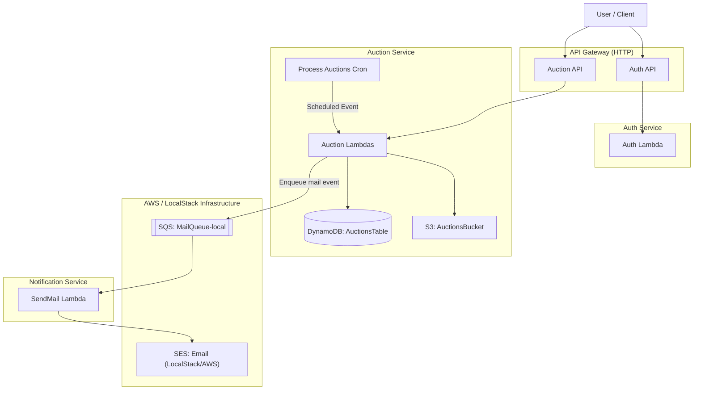

# 🛠️ Serverless Auction Platform

A **capstone project** built using **AWS**, following a **microservices architecture** with an **event-driven**, **serverless (FaaS)** design. This platform enables scalable, modular, and resilient online auctions using the [Serverless Framework](https://www.serverless.com/) deployed on AWS cloud services.

---

## 🏗️ High-Level Architecture



---

## 🧱 Architecture Overview

- **Architecture Style**: Microservices
- **Execution Model**: Serverless (FaaS - Function as a Service)
- **Design Pattern**: Event-Driven
- **Cloud Platform**: AWS
- **Use Case**: Capstone project demonstrating best practices in cloud-native application development

Each microservice is independently deployable and communicates via AWS-managed messaging and notification services, following the principles of loose coupling and asynchronous processing.

---

## 🚀 Tech Stack

- **Language**: Node.js
- **Framework**: Serverless Framework
- **Cloud Services**:
  - AWS Lambda (FaaS)
  - API Gateway
  - DynamoDB
  - SQS (Simple Queue Service)
  - SES (Simple Email Service)
  - CloudWatch (Monitoring)
- **Authentication**: JWT + Lambda Authorizer
- **Local Development**: LocalStack, Serverless Offline, Docker

---

## 📁 Project Structure

```bash
serverless-auction-platform/
│
├── auction-service/        # Handles listing, bidding, and auction state transitions
├── auth-service/           # Manages user authentication and authorization via JWT
├── notification-service/   # Sends email notifications via SQS + SES
├── scripts/                # Helper scripts for local dev and testing
├── docker-compose.yml      # LocalStack configuration
└── README.md               # Project documentation
```

---

## 📦 Features

### ✅ Auction Service

- Create auctions (default end time: one hour), list them by status, and get one by ID
- Place bids, with the rules checked by DynamoDB at write time so two bids at the same moment can't overwrite each other
- Upload an auction picture to S3 (seller only)
- A scheduled function closes ended auctions every minute and queues the result emails

### 🔐 Auth Service

- Lambda authorizer that verifies Auth0 JWTs (RS256, audience and issuer checked)
- Passes the user's email to the other services' API calls

### 📢 Notification Service

- Reads email requests from an SQS queue and sends them with SES
- Tells the seller the result and the winning bidder that they won
- Failed emails are retried, then kept in a dead-letter queue

---

## 🔧 Setup Instructions

### Prerequisites

- **Node.js** (v20.x recommended)
- **Docker** & **Docker Compose**
- **AWS CLI** (v2)
- **Serverless Framework** (v3)

### 1. Installation

Install dependencies for the root and all services:

```bash
# Root dependencies
npm install

# Service dependencies
cd auction-service && npm install && cd ..
cd auth-service && npm install && cd ..
cd notification-service && npm install && cd ..
```

### 2. Configure Dummy Credentials (LocalStack)

Configure AWS CLI to use dummy credentials for local testing (region `us-east-1` is preferred):

```bash
aws configure set aws_access_key_id test
aws configure set aws_secret_access_key test
aws configure set region us-east-1
```

---

## ⚙️ Usage (Local Development & Testing)

> **Tip**: On Windows, use **PowerShell** for `npm` commands and **Git Bash** for `bash` scripts / `curl` examples.

### 🔹 Quick Start (Local)

```bash
# 1. Install dependencies
npm install && cd auction-service && npm install && cd ..

# 2. Start LocalStack
npm run local:up

# 3. Start Auction API
npm run offline:auction
```

---

### 1. Start LocalStack

Use the provided script to start LocalStack and bootstrap required resources (DynamoDB tables, SQS queues, S3 buckets, SES identities):

```bash
npm run local:up
```

> **Note**: This runs `docker compose up` and executes `scripts/localstack-bootstrap.sh`. You should see `[Bootstrap] Done.` with no errors.

### 2. Run Services Locally

You can run each service in **separate terminal windows** using `serverless-offline`.

**Auction Service** (Port 3000):

```bash
npm run offline:auction
```

**Auth Service** (Port 3000 - _conflict warning_):

> _Note: By default, serverless-offline uses port 3000. If you run multiple services, override ports with `--httpPort` or only run the Auction Service when running tests._

```bash
npm run offline:auth
```

**Notification Service** (Port 3000 - _conflict warning_):

```bash
npm run offline:notify
```

### 3. Automated Tests (Docker)

To run the full suite of **Smoke Tests** and **E2E Tests** in a clean Docker environment:

```bash
npm run test:compose
```

> For the E2E tests, only the **Auction Service** needs to be running via `npm run offline:auction`. Auth and Notification are mocked or exercised indirectly via LocalStack.

This command:

1. Starts the Auction Service in the background.
2. Builds a test container (`tester`).
3. Runs `scripts/test-local.sh` (resource verification) and `scripts/test-e2e.sh` (API flows) against the local setup.

### 4. Manual Verification

You can manually trigger flows using `curl` or the provided helper script.

**Helper Script**:

```bash
# Requires 'jq' to be installed
bash scripts/verify-local-flow.sh
```

**Manual Commands**:

_Create an Auction:_

```bash
curl -X POST http://localhost:3000/auction \
  -H "Content-Type: application/json" \
  -d '{"title": "Test Auction"}'
```

_Place a Bid:_

```bash
# Replace {id} with the ID from the previous step
curl -X PATCH http://localhost:3000/auction/{id}/bid \
  -H "Content-Type: application/json" \
  -d '{"amount": 100}'
```

_Trigger Scheduled Process (Close Auctions):_
Since `serverless-offline` doesn't automatically trigger scheduled events, invoke the lambda manually:

```bash
aws --endpoint-url=http://localhost:3002 lambda invoke \
  --function-name auction-service-local-processAuctions \
  --payload '{}' \
  response.json
```

_(Note: Port `3002` is used here assuming `serverless-offline` exposes Lambda RPC. If not, use the LocalStack endpoint `http://localhost:4566` if deployed there. This simulates the scheduled `processAuctions` function that would normally be triggered by CloudWatch Events in AWS.)_

---

## 🏗️ Deployment (AWS)

**Important**: Before deploying, make sure you are using real AWS credentials, not the LocalStack `test` ones:

```bash
# Verify identity (should NOT be 'test')
aws sts get-caller-identity
```

The services depend on each other, so deploy them in this order:

1. **notification-service** creates the mail queue; auction-service reads its URL and ARN from this stack.
2. **auth-service** creates the authorizer function that auction-service's API uses.
3. **auction-service**.

```bash
# 1. Notification service. SENDER_EMAIL must be a verified SES identity
#    (in the SES sandbox, recipients must be verified too).
cd notification-service
SENDER_EMAIL=you@example.com sls deploy --stage dev

# 2. Auth service. Put your Auth0 tenant's signing certificate in
#    auth-service/secret.pem (it is git-ignored), then:
cd ../auth-service
AUTH0_AUDIENCE=https://your-api-identifier AUTH0_ISSUER=https://your-tenant.auth0.com/ \
  sls deploy --stage dev

# 3. Auction service
cd ../auction-service
sls deploy --stage dev
```

Notes:

- Lambda provides the region and the function's role credentials itself. The services only use the LocalStack endpoint and the dummy `test` credentials when `LOCAL_AWS_ENDPOINT` is set (the `local` stage).
- Auth0 access tokens must include an `email` claim, which the auction service uses as the seller / bidder identity.
- Emails that fail 3 times move to the `MailQueue-<stage>-dlq` dead-letter queue.
- Auction pictures must be base64-encoded JPEGs of 4 MB or less.

---

## 👨‍💻 Author

**Harshana Lakshara**
GitHub: [@UchihaIthachi](https://github.com/UchihaIthachi)

---

## 🪪 License

This project is licensed under the [MIT License](LICENSE).
