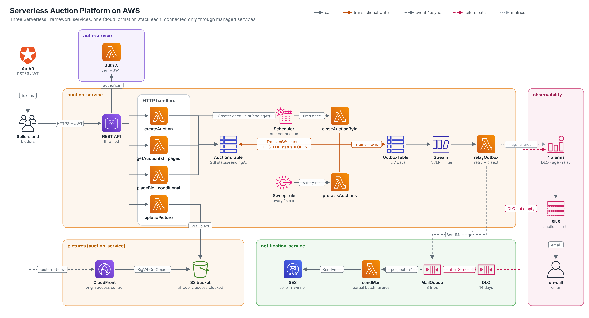
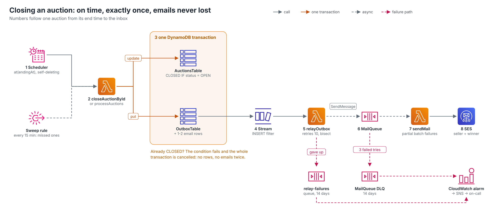
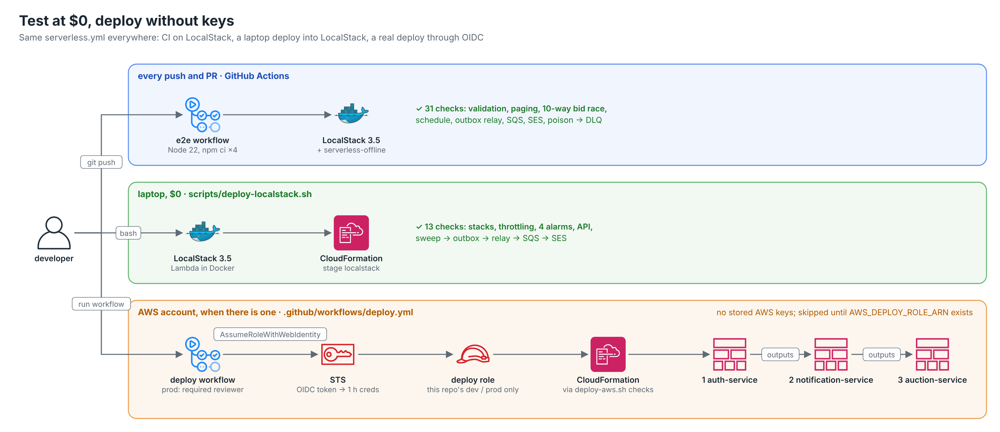

# 🛠️ Serverless Auction Platform

[](https://github.com/UchihaIthachi/serverless-auction-platform/actions/workflows/e2e.yml)




**Highlights**
- **Concurrency-safe bidding.** The bid check and the write are one conditional DynamoDB update. A 10-way race test proves exactly one bid wins.
- **Closes on time, exactly once.** One EventBridge Scheduler entry per auction fires at its end time, and a 15-minute sweep is the safety net. A conditional close means the two never both send emails.
- **No lost emails.** Transactional outbox: the close and its emails commit in one DynamoDB transaction, and a stream relay puts them on SQS (partial batch failures, retries, then a DLQ).
- **Protected and observable.** API Gateway throttling per stage and on bidding; private S3 behind CloudFront (origin access control); CloudWatch alarms on the DLQ and relay go to SNS ([runbook](docs/runbook-alarms.md)).
- **Tested at $0, two ways.** `npm run test:e2e`: 31 checks on LocalStack + serverless-offline, in CI on every push and PR. `deploy-localstack.sh`: the real CloudFormation stacks deployed into LocalStack, with a smoke test through API Gateway.
- **Deploys without keys:** a GitHub Actions workflow using OIDC ([setup](docs/deploy-oidc.md)). **Costed:** about $0.85 a month at small scale ([cost](docs/cost.md)). **Reviewed:** [Well-Architected, 6 pillars](docs/well-architected.md).

Docs: [architecture atlas (22 diagrams + tables)](docs/architecture.md) · [cost estimate](docs/cost.md) · [Well-Architected review](docs/well-architected.md) · [alarm runbook](docs/runbook-alarms.md) · [OIDC deploy setup](docs/deploy-oidc.md)

A **capstone project** built using **AWS**, following a **microservices architecture** with an **event-driven**, **serverless (FaaS)** design. This platform enables scalable, modular, and resilient online auctions using the [Serverless Framework](https://www.serverless.com/) deployed on AWS cloud services.

---

## 🏗️ High-Level Architecture

Three Serverless Framework services, each its own CloudFormation stack, talking only through AWS managed services. The picture above is the whole system; these two show the paths that matter most.

**Closing an auction, end to end.** The per-auction schedule (or the 15-minute safety sweep) closes it in one DynamoDB transaction together with its emails; the stream relays them to SQS, and failures land in queues that raise alarms.



**Test at $0, deploy without keys.** Every push runs the e2e test on LocalStack; the same stacks deploy into LocalStack from a laptop; a real deploy uses GitHub OIDC → STS → a role trusted only for this repository.



Every detail (auth, bid race, data model, throttling, alarms, failure modes, cost) is in the [architecture atlas](docs/architecture.md). The icon diagrams are generated by [`docs/diagrams/aws_diagrams.py`](docs/diagrams/aws_diagrams.py): official AWS icons, laid out on a grid so every line is straight.

---

## 🧱 Architecture Overview

- **Architecture Style**: Microservices
- **Execution Model**: Serverless (FaaS - Function as a Service)
- **Design Pattern**: Event-Driven
- **Cloud Platform**: AWS
- **Use Case**: Capstone project demonstrating best practices in cloud-native application development

Each microservice is independently deployable and communicates via AWS-managed messaging and notification services, following the principles of loose coupling and asynchronous processing.

---

## 🚀 Tech Stack

- **Language**: Node.js
- **Framework**: Serverless Framework
- **Cloud Services**:
  - AWS Lambda (FaaS)
  - API Gateway
  - DynamoDB
  - SQS (Simple Queue Service)
  - SES (Simple Email Service)
  - CloudWatch (Monitoring)
- **Authentication**: JWT + Lambda Authorizer
- **Local Development**: LocalStack, Serverless Offline, Docker

---

## 📁 Project Structure

```bash
serverless-auction-platform/
│
├── auction-service/        # Handles listing, bidding, and auction state transitions
├── auth-service/           # Manages user authentication and authorization via JWT
├── notification-service/   # Sends email notifications via SQS + SES
├── scripts/                # Helper scripts for local dev and testing
├── docker-compose.yml      # LocalStack configuration
└── README.md               # Project documentation
```

---

## 📦 Features

### ✅ Auction Service

- Create auctions (default end time: one hour), list them by status, and get one by ID
- Place bids, with the rules checked by DynamoDB at write time so two bids at the same moment can't overwrite each other
- Upload an auction picture to S3 (seller only)
- List auctions a page at a time (`limit`, and the `X-Next-Token` response header as the cursor)
- Each auction gets a one-time EventBridge Scheduler entry that closes it at its end time; a 15-minute sweep closes anything missed
- Closing writes the result emails to an outbox table in the same transaction; a stream-triggered relay queues them

### 🔐 Auth Service

- Lambda authorizer that verifies Auth0 JWTs (RS256, audience and issuer checked)
- Passes the user's email to the other services' API calls

### 📢 Notification Service

- Reads email requests from an SQS queue and sends them with SES
- Tells the seller the result and the winning bidder that they won
- Failed emails are retried, then kept in a dead-letter queue

---

## 🔧 Setup Instructions

### Prerequisites

- **Node.js** (v20.x recommended)
- **Docker** & **Docker Compose**
- **AWS CLI** (v2)
- **Serverless Framework** (v3)

### 1. Installation

Install dependencies for the root and all services:

```bash
# Root dependencies
npm install

# Service dependencies
cd auction-service && npm install && cd ..
cd auth-service && npm install && cd ..
cd notification-service && npm install && cd ..
```

### 2. Configure Dummy Credentials (LocalStack)

Configure AWS CLI to use dummy credentials for local testing (region `us-east-1` is preferred):

```bash
aws configure set aws_access_key_id test
aws configure set aws_secret_access_key test
aws configure set region us-east-1
```

---

## ✅ End-to-end test on your laptop ($0)

`npm run test:e2e` (`scripts/e2e-local.sh`) starts LocalStack (DynamoDB, SQS, S3, SES, Scheduler) and the auction API on serverless-offline. It then checks the whole flow, with no AWS account needed:

| Area | Checks |
|---|---|
| Validation | empty title, end date in the past and a bid of 0 → 400; unknown auction → 404 |
| CRUD | create 201, get and list 200, bid 200 |
| Paging | `limit=1` returns one item and an `X-Next-Token`; the next page differs; a bad token or `limit=0` → 400 |
| Scheduler | creating an auction creates `auction-<id>`: an `at()` expression targeting `closeAuctionById` (self-delete is checked where the emulator returns it; LocalStack 3.5 doesn't) |
| **Concurrency** | 10 identical bids race; **exactly one wins** (the conditional write on `highestBid.amount`), and the stored amount is correct |
| Closing | an auction ending in 4 s is closed by `processAuctions`; a second run closes nothing twice |
| Outbox | the close wrote exactly 2 outbox rows; `relayOutbox`, given them as a stream event, reports no failures |
| Messaging | exactly 2 emails queued in SQS (seller and winner) |
| Scheduled close | `closeAuctionById`: before the end → no-op; at the end → closed; again → no-op; 1 outbox row (no bids) |
| Email | `sendMail` sends both through SES with no batch failures; LocalStack's SES endpoint shows both |
| Failure path | a message without a recipient comes back as a batch item failure, so SQS retries it and then moves it to the DLQ |

Last run (LocalStack 3.5 on a Mac): **31 passed, 0 failed**. Requires Docker, Node, Python 3 and the AWS CLI. LocalStack is pinned to the community image `3.5`, which needs no account.

## 🧪 "First deploy" into LocalStack ($0)

`bash scripts/deploy-localstack.sh` deploys the **same `serverless.yml` stacks** as AWS (stage `localstack`) into LocalStack's CloudFormation. It then smoke-tests through the deployed API Gateway, so the event wiring is exercised for real: sweep rule → transactional close → OutboxTable stream → `relayOutbox` → SQS → `sendMail` → SES. It also checks the stacks, the stage and bid throttling settings, the 4 alarms and the stream mapping. It takes about 3–4 minutes and needs Docker running. Last run (LocalStack 3.5 on a Mac): **13 passed, 0 failed**: both stacks, both throttling limits, 4 alarms, the stream mapping, create/get/bid through API Gateway, the per-auction schedule, the sweep closing the auction, and both emails arriving in SES.

Not in LocalStack community, so not part of this stage: CloudFront (off via `useCdn`), the Auth0 authorizer, and schedules actually firing. Schedules are created; the sweep does the closing.

## ⚙️ Usage (Local Development & Testing)

> **Tip**: On Windows, use **PowerShell** for `npm` commands and **Git Bash** for `bash` scripts / `curl` examples.

### 🔹 Quick Start (Local)

```bash
# 1. Install dependencies
npm install && cd auction-service && npm install && cd ..

# 2. Start LocalStack
npm run local:up

# 3. Start Auction API
npm run offline:auction
```

---

### 1. Start LocalStack

Use the provided script to start LocalStack and bootstrap required resources (DynamoDB tables, SQS queues, S3 buckets, SES identities):

```bash
npm run local:up
```

> **Note**: This runs `docker compose up` and executes `scripts/localstack-bootstrap.sh`. You should see `[Bootstrap] Done.` with no errors.

### 2. Run Services Locally

You can run each service in **separate terminal windows** using `serverless-offline`.

**Auction Service** (Port 3000):

```bash
npm run offline:auction
```

**Auth Service** (Port 3000 - _conflict warning_):

> _Note: By default, serverless-offline uses port 3000. If you run multiple services, override ports with `--httpPort` or only run the Auction Service when running tests._

```bash
npm run offline:auth
```

**Notification Service** (Port 3000 - _conflict warning_):

```bash
npm run offline:notify
```

### 3. Automated Tests (Docker)

To run the full suite of **Smoke Tests** and **E2E Tests** in a clean Docker environment:

```bash
npm run test:compose
```

> For the E2E tests, only the **Auction Service** needs to be running via `npm run offline:auction`. Auth and Notification are mocked or exercised indirectly via LocalStack.

This command:

1. Starts the Auction Service in the background.
2. Builds a test container (`tester`).
3. Runs `scripts/test-local.sh` (resource verification) and `scripts/test-e2e.sh` (API flows) against the local setup.

### 4. Manual Verification

You can manually trigger flows using `curl` or the provided helper script.

**Helper Script**:

```bash
# Requires 'jq' to be installed
bash scripts/verify-local-flow.sh
```

**Manual Commands**:

_Create an Auction:_

```bash
curl -X POST http://localhost:3000/auction \
  -H "Content-Type: application/json" \
  -d '{"title": "Test Auction"}'
```

_Place a Bid:_

```bash
# Replace {id} with the ID from the previous step
curl -X PATCH http://localhost:3000/auction/{id}/bid \
  -H "Content-Type: application/json" \
  -d '{"amount": 100}'
```

_Trigger Scheduled Process (Close Auctions):_
Since `serverless-offline` doesn't automatically trigger scheduled events, invoke the lambda manually:

```bash
aws --endpoint-url=http://localhost:3002 lambda invoke \
  --function-name auction-service-local-processAuctions \
  --payload '{}' \
  response.json
```

_(Note: Port `3002` is used here assuming `serverless-offline` exposes Lambda RPC. If not, use the LocalStack endpoint `http://localhost:4566` if deployed there. This simulates the scheduled `processAuctions` function that would normally be triggered by CloudWatch Events in AWS.)_

---

## 🏗️ Deployment (AWS)

Three scripts handle a real deployment. You run them yourself with your own AWS profile; no access keys are stored in the repo or the scripts.

### One-time setup

1. **AWS account safety.** Turn on MFA for the root user and never use it day to day. Create an IAM Identity Center user, then `aws configure sso` with a profile, for example `auction`.
2. **A cost guard before anything else.** Create a $5 monthly budget with email alerts. `deploy-aws.sh` refuses to run without one:
   ```bash
   ACC=$(aws sts get-caller-identity --query Account --output text)
   aws budgets create-budget --account-id "$ACC" \
     --budget '{"BudgetName":"monthly-5usd","BudgetLimit":{"Amount":"5","Unit":"USD"},"TimeUnit":"MONTHLY","BudgetType":"COST"}' \
     --notifications-with-subscribers '[
       {"Notification":{"NotificationType":"ACTUAL","ComparisonOperator":"GREATER_THAN","Threshold":80,"ThresholdType":"PERCENTAGE"},"Subscribers":[{"SubscriptionType":"EMAIL","Address":"you@example.com"}]},
       {"Notification":{"NotificationType":"FORECASTED","ComparisonOperator":"GREATER_THAN","Threshold":100,"ThresholdType":"PERCENTAGE"},"Subscribers":[{"SubscriptionType":"EMAIL","Address":"you@example.com"}]}]'
   ```
3. **Auth0** (free tenant):
   - Create an **API**. Its identifier becomes `AUTH0_AUDIENCE`, and the issuer is `https://<tenant>.auth0.com/`.
   - Download the tenant's signing certificate: Applications → your app → Settings → Advanced → Certificates. Save it as `auth-service/secret.pem` (git-ignored).
   - Add a post-login **Action** so access tokens carry the user's email. Auth0 drops a plain `email` claim in some flows, so it is namespaced:
     ```js
     exports.onExecutePostLogin = async (event, api) => {
       api.accessToken.setCustomClaim('https://serverless-auction/email', event.user.email);
     };
     ```
4. **SES** (sandbox): verify the sender, and every recipient while in the sandbox:
   `aws sesv2 create-email-identity --email-identity you@example.com`, then click the link in the email.

### Deploy, test, remove

```bash
export AWS_PROFILE=auction AUTH0_AUDIENCE=https://auction-api AUTH0_ISSUER=https://<tenant>.auth0.com/ SENDER_EMAIL=you@example.com
bash scripts/deploy-aws.sh                 # checks identity, budget, Auth0 inputs, SES; deploys auth -> notification -> auction
TOKEN=<access token> bash scripts/smoke-aws.sh   # 401 without/with a bad token, create 201, get/list 200, seller's own bid 403
bash scripts/teardown-aws.sh               # empties the bucket and removes all three stacks
```

To get an access token for the smoke test, sign in through your Auth0 application (or use the API's Test tab for a machine token). A second user's token (`TOKEN2`) adds a real bid and a rejected lower bid.

Notes:

- The deploy order matters. auth-service provides the authorizer, notification-service provides the mail queue, and auction-service reads both through CloudFormation outputs.
- The bucket name includes the account ID (`auctions-<account>-<stage>`), so it is globally unique.
- Lambda supplies the region and role credentials. The LocalStack endpoint and `test` credentials are only used when `LOCAL_AWS_ENDPOINT` is set (the `local` stage).
- Emails that fail 3 times move to `MailQueue-<stage>-dlq`, which raises an alarm. Set `ALERT_EMAIL` before deploying to receive alarms (confirm the SNS subscription email).
- Pictures are served through CloudFront; the bucket is private, and `pictureUrl` uses the distribution's domain.
- Throttling (requests per second, burst) is set per stage in `auction-service/config/config.<stage>.yml` and applied after each deploy by `auction-service/plugins/stage-throttling.js`.
- CI/CD alternative: the `deploy` workflow (OIDC, no stored keys). Setup in [docs/deploy-oidc.md](docs/deploy-oidc.md).
- Runtime: `nodejs22.x`. Lambda deprecated `nodejs20.x` on 30 Apr 2026. Serverless Framework v3 predates Node 22 and prints a runtime warning, which is harmless.
- Pictures must be base64-encoded JPEGs of 4 MB or less.

---

## 👨‍💻 Author

**Harshana Lakshara**
GitHub: [@UchihaIthachi](https://github.com/UchihaIthachi)

---

## 🪪 License

This project is licensed under the [MIT License](LICENSE).
