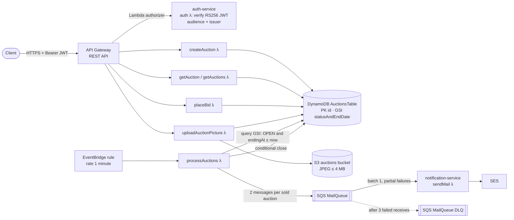
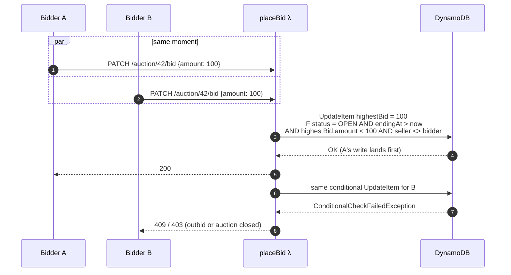
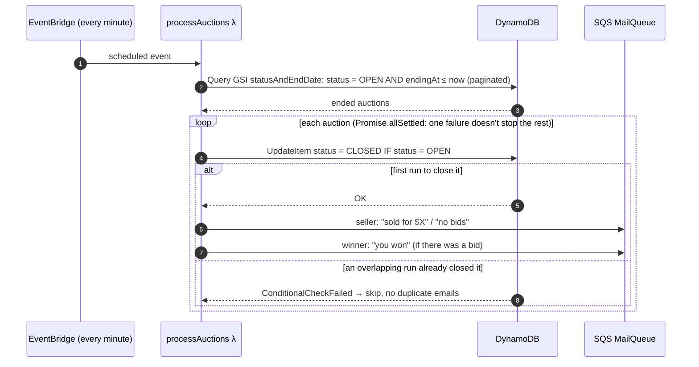
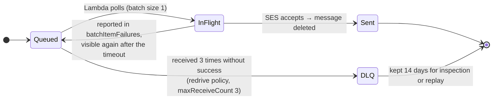
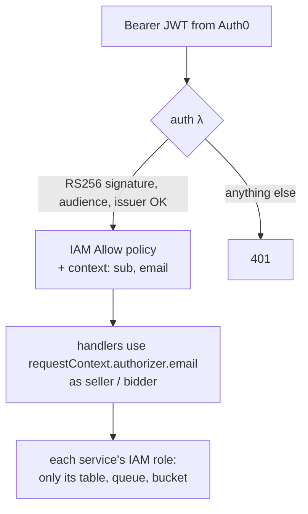

# Architecture

Three Serverless Framework services, communicating only through AWS managed services. All of it runs locally on LocalStack + serverless-offline (`npm run test:e2e`), and on AWS with `scripts/deploy-aws.sh`.

## 1. Components

## 2. Placing a bid safely under concurrency

The check and the write are **one atomic DynamoDB operation**. A read-then-write in Lambda code would let both bids pass the check before either writes. The local e2e test fires 10 identical bids at once: exactly one gets 200.

## 3. Closing auctions

## 4. Email delivery, retries and the DLQ

`sendMail` returns `batchItemFailures` with only the failed message IDs, so one bad message doesn't make SQS redeliver the good ones.

## 5. Security

There is no fallback identity on AWS. Only the `local` stage (serverless-offline, no authorizer) uses test emails.
