# Serverless Auction Platform: architecture atlas

Every diagram of the system in one place: request paths, auth, concurrency, per-auction scheduling, the transactional outbox, messaging, throttling, alarms, data, local environments, CI/CD, cost and growth. They are Mermaid, so they render on GitHub and are reviewed like code. Facts come from the code (`serverless.yml`, handlers, `resources/`) and from the two local test runs: `scripts/e2e-local.sh` (serverless-offline, 31 checks, run in CI) and `scripts/deploy-localstack.sh` (the real CloudFormation stacks deployed into LocalStack).

| # | Diagram | Answers |
|---|---|---|
| 1 | [System context](#1-system-context) | Who uses it, what it depends on |
| 2 | [Components](#2-components) | Services, functions, AWS resources |
| 3 | [Stacks and deploy order](#3-stacks-and-deploy-order) | Three CloudFormation stacks and how they reference each other |
| 4 | [Authorizer](#4-authorizer) | How a JWT becomes a seller or bidder identity |
| 5 | [Create auction](#5-create-auction) | Validation, insert, per-auction schedule |
| 6 | [Bid decision](#6-bid-decision) | Every check a bid goes through, with status codes |
| 7 | [Bid race](#7-bid-race) | Why two simultaneous bids can't both win |
| 8 | [Picture upload and delivery](#8-picture-upload-and-delivery) | JPEG check, private S3, CloudFront with OAC |
| 9 | [Auction lifecycle](#9-auction-lifecycle) | States and what's allowed in each |
| 10 | [Closing on time](#10-closing-on-time) | EventBridge Scheduler per auction, sweep as safety net |
| 11 | [Transactional outbox](#11-transactional-outbox) | Why a close can't lose or half-send its emails |
| 12 | [Outbox relay](#12-outbox-relay) | Stream → relayOutbox → SQS, retries, failures |
| 13 | [Email lifecycle](#13-email-lifecycle) | Retries, partial failures, DLQ |
| 14 | [Data model](#14-data-model) | Both tables, keys, GSI, TTL |
| 15 | [Access patterns](#15-access-patterns) | Each query and the key it uses |
| 16 | [Throttling](#16-throttling) | Stage and per-method limits, 429s |
| 17 | [Alarms](#17-alarms) | What pages someone, and why |
| 18 | [Security and IAM](#18-security-and-iam) | Who can do what |
| 19 | [Local environments](#19-local-environments) | serverless-offline e2e vs full LocalStack deploy |
| 20 | [CI and deploy pipelines](#20-ci-and-deploy-pipelines) | e2e on every push; OIDC deploy, no keys |
| 21 | [Failure modes](#21-failure-modes) | What breaks and what users see |
| 22 | [Cost breakdown](#22-cost-breakdown) | Where the money would go |
| 23 | [Growth path](#23-growth-path) | What's done, what's next at 10× and 100× |

### At a glance (AWS icons)

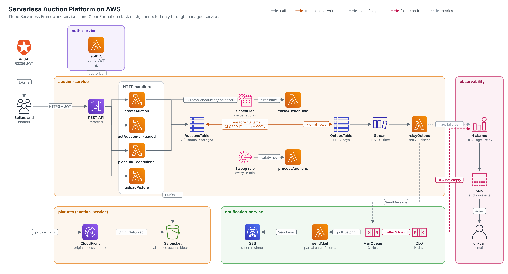

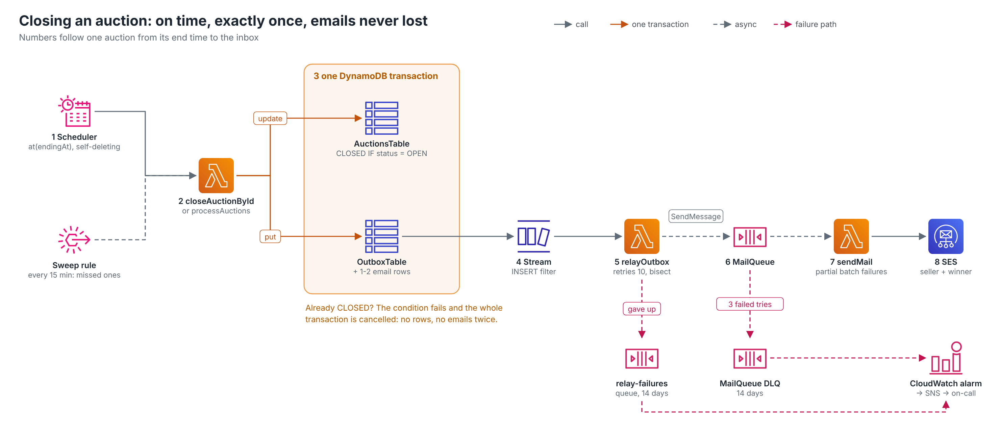

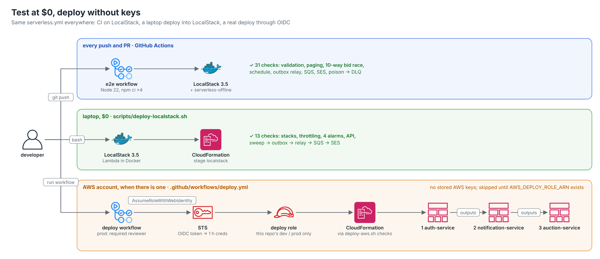

Generated by [`diagrams/aws_diagrams.py`](diagrams/aws_diagrams.py) (`pip install diagrams`, needs Graphviz). The Mermaid diagrams below are the detailed, reviewable source.

---

## 1. System context

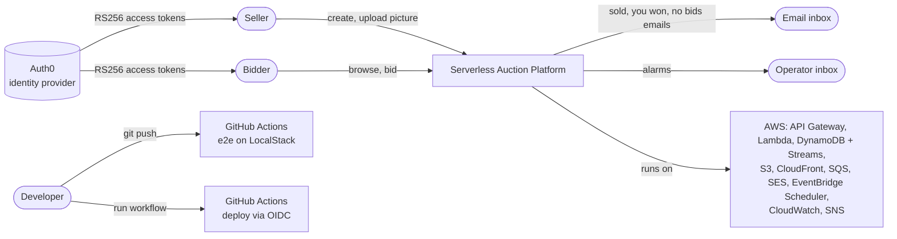

## 2. Components

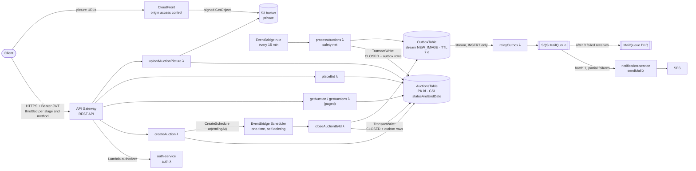

## 3. Stacks and deploy order

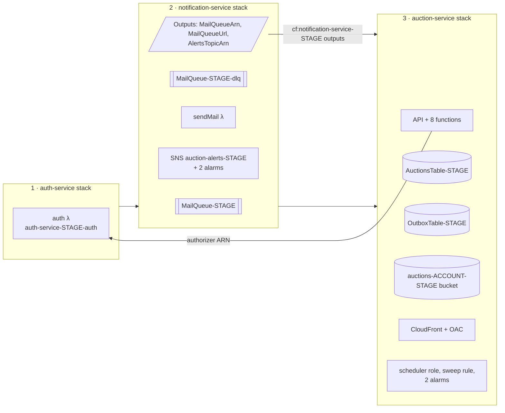

`scripts/deploy-aws.sh` deploys in this order after checking identity, budget, Auth0 inputs and SES. `teardown-aws.sh` removes them in reverse, after emptying the bucket. `scripts/deploy-localstack.sh` deploys stacks 2 and 3 from the same `serverless.yml` into LocalStack (stage `localstack`: no CloudFront, no Auth0).

## 4. Authorizer

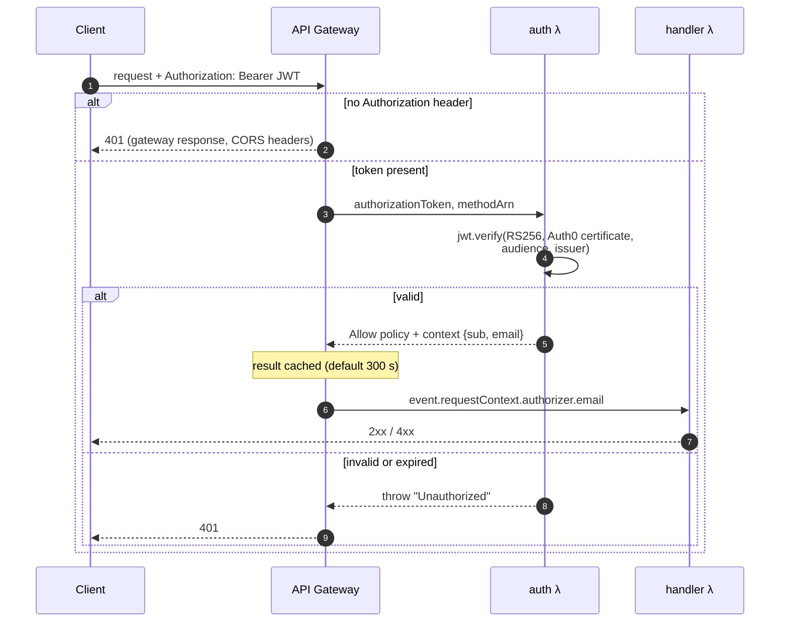

The email comes from the namespaced claim `https://serverless-auction/email`, which a post-login Auth0 Action adds. A plain `email` claim is also accepted.

## 5. Create auction

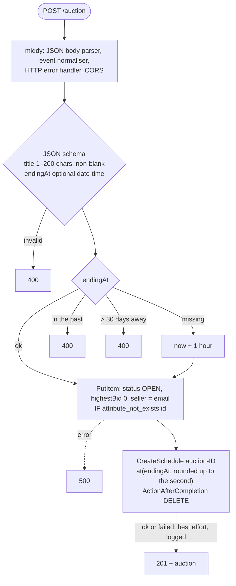

The schedule is best effort on purpose: the auction is already saved, and if the schedule can't be created the 15-minute sweep closes it instead. Losing a schedule delays a close; it never loses one.

## 6. Bid decision

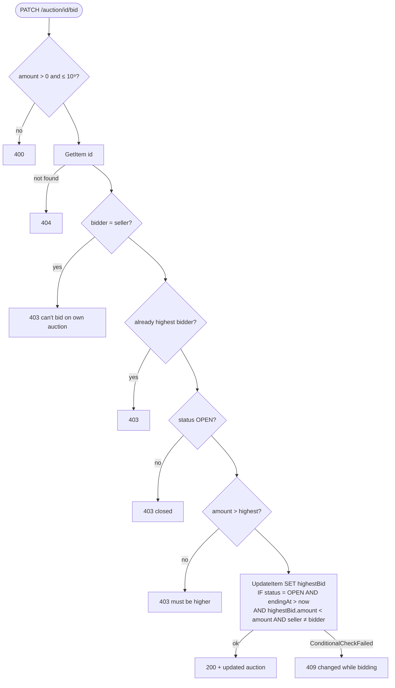

The checks before the update give clear messages. The **condition on the update** is what makes it correct, because DynamoDB re-checks it atomically at write time.

## 7. Bid race

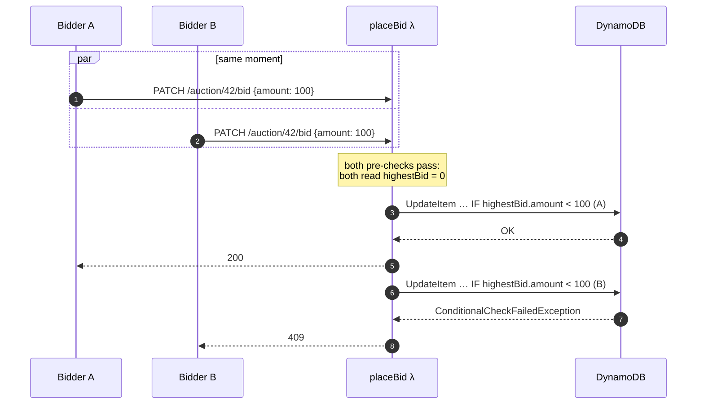

Without the condition, both pre-checks pass and the second write silently overwrites the first. The e2e test fires 10 identical bids at once and asserts exactly one 200, with 100 stored.

## 8. Picture upload and delivery

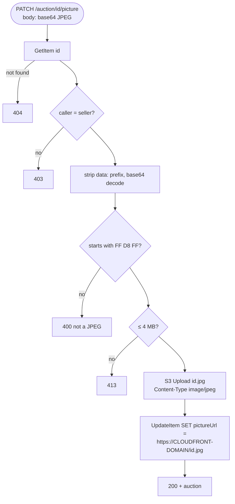

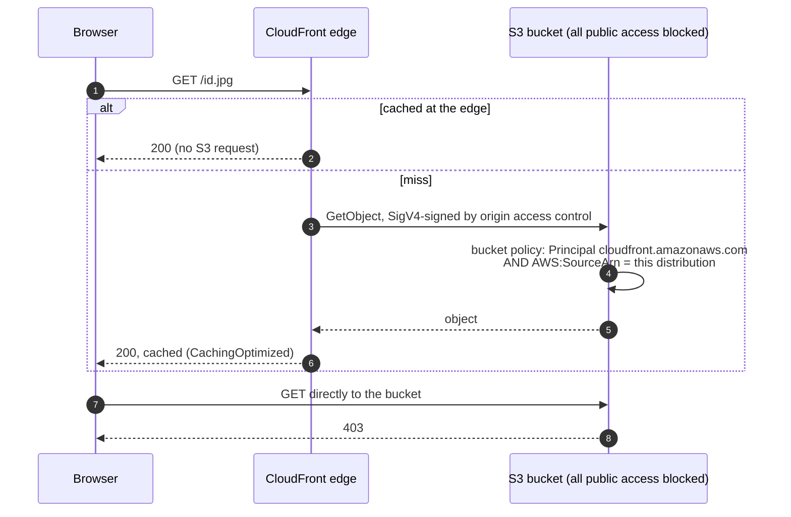

Why 4 MB: Lambda's synchronous payload limit is 6 MB, and base64 adds about 33%. CloudFront is only in dev/prod (`useCdn`); LocalStack community has no CloudFront, so the `localstack` and `local` stages keep a public-read bucket.

## 9. Auction lifecycle

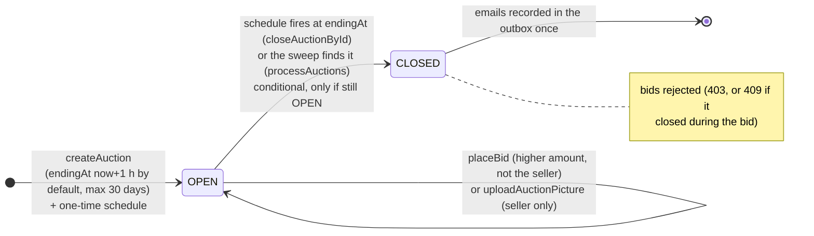

## 10. Closing on time

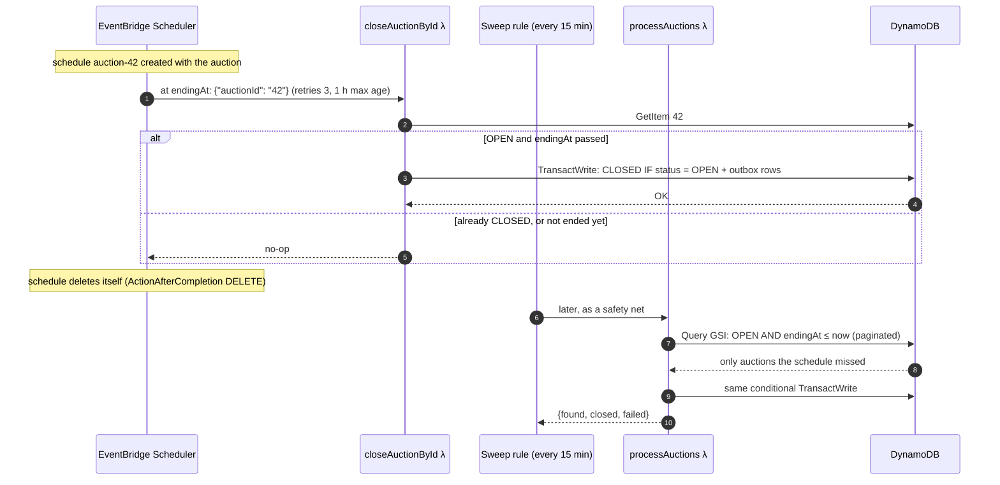

Before: a cron every minute, 43,200 runs a month, most finding nothing, and up to 60 s late. Now: one invocation per auction, at the second it ends. The sweep went from every minute to every 15 minutes because it only covers failures. Both paths share `closeAuction`, so whichever runs second finds the auction CLOSED and does nothing. The e2e test calls `closeAuctionById` early (no-op), on time (closes) and again (no-op), and checks the schedule's expression, target and self-delete setting.

## 11. Transactional outbox

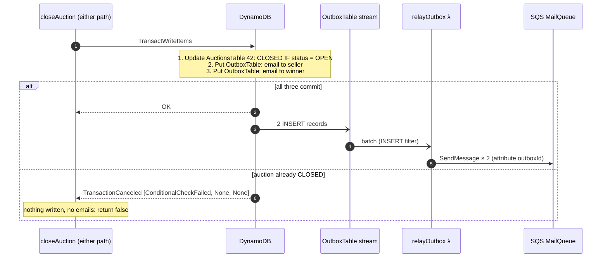

The problem it fixes: before, the close was one write and the two `SendMessage` calls came after it. A timeout or crash between them left an auction CLOSED with no emails, and nothing would ever retry, because the next run sees CLOSED and skips. With the outbox the state change and the "emails to send" record commit **atomically**, and the stream delivers them later with retries. Cost: a transaction costs 2 WRU per item, so a close is 6 WRU instead of 1 (about $0.004 a month at small scale).

## 12. Outbox relay

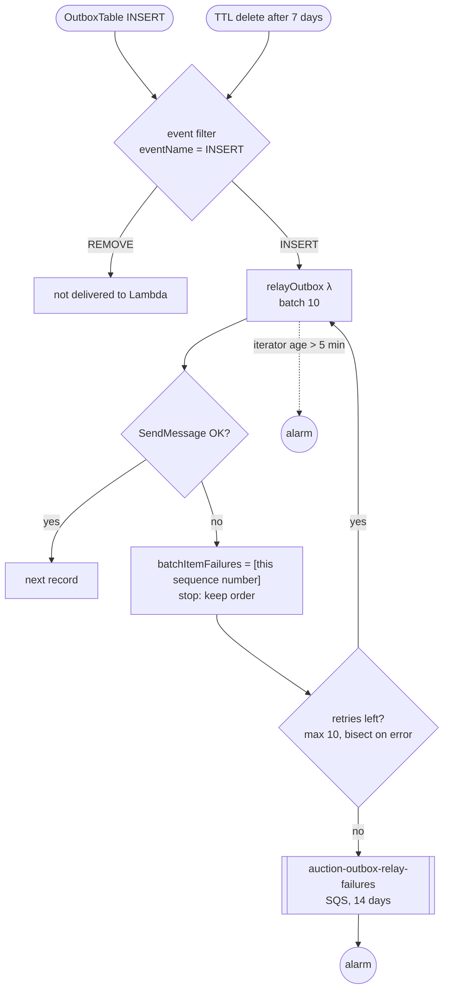

Delivery is at-least-once: a retried batch can resend a record that already went out, so each message carries its `outboxId` for deduplication. A batch that gives up leaves the rows in OutboxTable (7-day TTL), so they can be replayed by `aggregateId`.

## 13. Email lifecycle

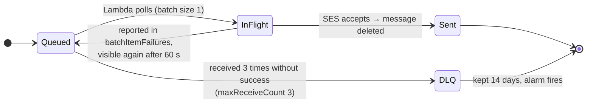

`sendMail` returns only the failed message IDs, so one bad message doesn't make SQS redeliver the good ones. The visibility timeout (60 s) is longer than the function timeout, as AWS recommends.

## 14. Data model

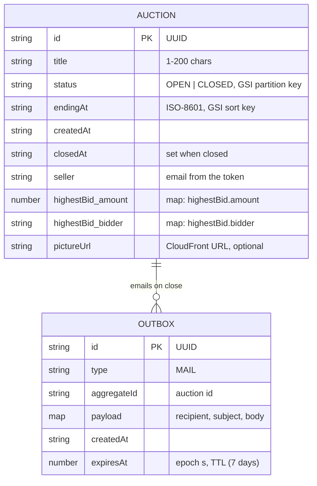

Two on-demand tables per stage. `AuctionsTable`'s GSI `statusAndEndDate` (`status` + `endingAt`, projection ALL) serves both the list and the sweep query. ISO-8601 strings sort correctly as text, so `endingAt <= now` works as a range condition. `OutboxTable` is append-only with a `NEW_IMAGE` stream.

## 15. Access patterns

| Pattern | Operation | Key | Used by |
|---|---|---|---|
| Get one auction | GetItem | `id` | getAuction, placeBid, uploadAuctionPicture, closeAuctionById |
| List auctions by status, a page at a time | Query GSI | `status = :s`, `Limit` 1–100, `ExclusiveStartKey` from `nextToken` | getAuctions |
| Find ended auctions | Query GSI | `status = OPEN AND endingAt <= now` | processAuctions (all pages) |
| Create | PutItem | `attribute_not_exists(id)` | createAuction |
| Bid | UpdateItem | conditional on status, endingAt, amount, seller | placeBid |
| Close + record emails | TransactWriteItems | Update `IF status = OPEN` + 1–2 outbox Puts | closeAuction |
| Relay emails | DynamoDB Streams (Lambda poller) | OutboxTable shard iterator | relayOutbox |

There are no Scans. Paging keeps the body a plain array (backwards compatible) and returns the cursor in an `X-Next-Token` header: base64url of DynamoDB's `LastEvaluatedKey`, validated on the way back in (a malformed token, or one from another status, is a 400).

## 16. Throttling

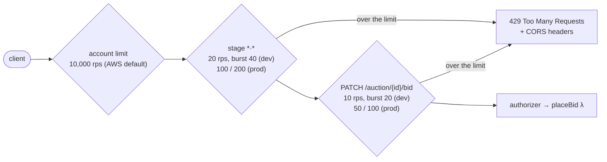

API Gateway rejects excess requests **before** any Lambda, DynamoDB or authorizer work, so a flood costs only API Gateway requests. Bidding gets the tightest limit because it's the hottest write. Serverless Framework v3 can't put stage method settings in the template, so `auction-service/plugins/stage-throttling.js` applies them with `UpdateStage` after every deploy, from `custom.throttling`. The limits are per stage in `config/config.<stage>.yml`. The 429s carry CORS headers via the `DEFAULT_4XX` gateway response, so browsers can read them.

## 17. Alarms

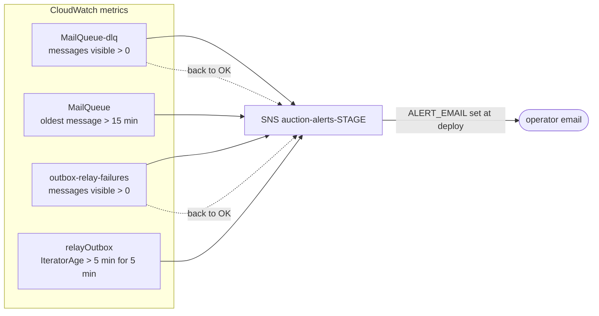

| Alarm | Means | First thing to check |
|---|---|---|
| `mail-dlq-not-empty` | An email failed 3 times | `sendMail` logs; SES identity / sandbox recipient |
| `mail-queue-stuck` | Emails aren't being consumed | `sendMail` errors or throttling; SES sending paused |
| `outbox-relay-failures` | The relay gave up on a batch | Replay that auction's rows from OutboxTable |
| `outbox-relay-lag` | The relay is behind or retrying | `relayOutbox` errors; SQS permissions |

All four use `TreatMissingData: notBreaching`, so a quiet system stays green. Four alarms fit in CloudWatch's 10 free standard alarms.

## 18. Security and IAM

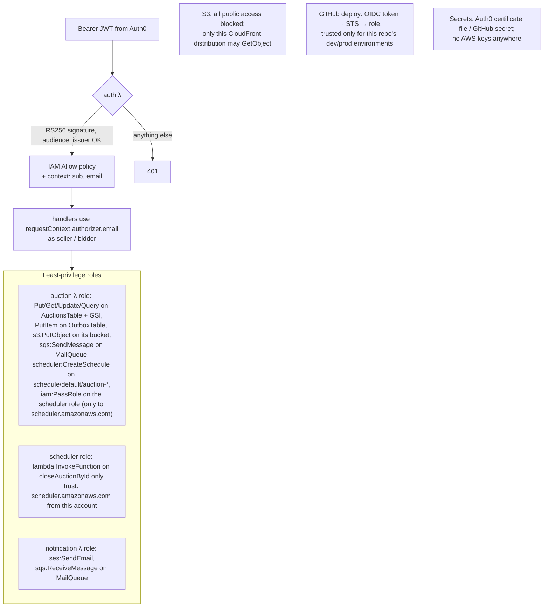

There is no fallback identity on AWS: only the `local` and `localstack` stages, with no authorizer, use test emails, and the serverless-localstack plugin can only deploy those two stages to localhost.

## 19. Local environments

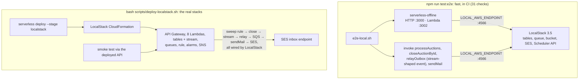

Both are $0: LocalStack 3.5 community needs no account token. Mode (a) invokes the event-driven functions directly, since serverless-offline doesn't run streams or schedules. Mode (b) checks the wiring itself: CloudFormation, event source mappings, the throttling plugin and the alarms. In mode (b) functions run on `nodejs20.x`, because LocalStack 3.5 has no `nodejs22.x`, and the code is built for Node 20 so both work.

## 20. CI and deploy pipelines

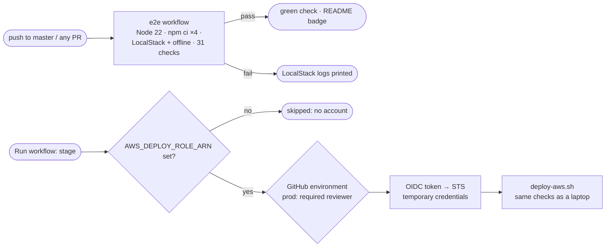

The deploy workflow has never run, because there's no AWS account. It is written, and the job is skipped until the role variable exists. Setup and the trust policy: [deploy-oidc.md](deploy-oidc.md).

## 21. Failure modes

| Failure | What users see | Why |
|---|---|---|
| Two bids at the same moment | One 200, one 409 | Conditional update (diagram 7) |
| Bid as the auction ends | 409 or 403, never a bid on a closed auction | `endingAt > now` in the condition |
| Schedule and sweep both close it | Closed and emailed once | `IF status = OPEN` inside the transaction |
| Schedule couldn't be created | Closed by the sweep, up to 15 min late | Best-effort create, sweep safety net |
| Crash right after the close | Emails still go out | Close and outbox rows commit together (diagram 11) |
| SQS unavailable during relay | Emails delayed, not lost | Stream retries, then failure queue + alarm |
| SES rejects an email | Retried, then DLQ for 14 days + alarm | Partial batch failures + redrive |
| Malformed queue message | Goes to the DLQ, others unaffected | Reported as a batch item failure |
| Bad, expired or missing token | 401 | Authorizer + gateway responses |
| Request flood | 429 at the gateway, no Lambda cost | Stage + per-method throttling |
| Picture not a JPEG / too big | 400 / 413 | Magic bytes + size check before S3 |
| Direct S3 picture link | 403 | Bucket private; CloudFront OAC only |
| Many auctions in one status | Paged results, `X-Next-Token` | Limit + cursor on getAuctions |

## 22. Cost breakdown

```mermaid
pie showData title Monthly cost at small scale (USD, us-east-1, ≈ $0.85 total)
  "API Gateway REST" : 0.43
  "SES" : 0.20
  "CloudWatch Logs" : 0.15
  "DynamoDB" : 0.05
  "S3" : 0.01
```

Lambda, SQS, EventBridge Scheduler, CloudFront, the four alarms and SNS email all stay inside their free allowances at this scale. The assumptions and the 10× / 100× numbers are in [cost.md](cost.md).

## 23. Growth path

```mermaid
flowchart LR
  done["Done<br/>EventBridge Scheduler per auction<br/>CloudFront + origin access control<br/>transactional outbox + stream relay<br/>paged getAuctions<br/>stage + per-method throttling<br/>DLQ / lag alarms → SNS<br/>OIDC deploy workflow"] --> x10
  x10["10×<br/>HTTP API + JWT authorizer (≈70% cheaper)<br/>dedupe emails by outboxId<br/>structured logs + X-Ray traces"] --> x100
  x100["100×<br/>provisioned capacity + auto scaling for steady load<br/>SES dedicated IP, bounce and complaint handling<br/>WAF with per-client rate rules<br/>multi-region read path"]
```
