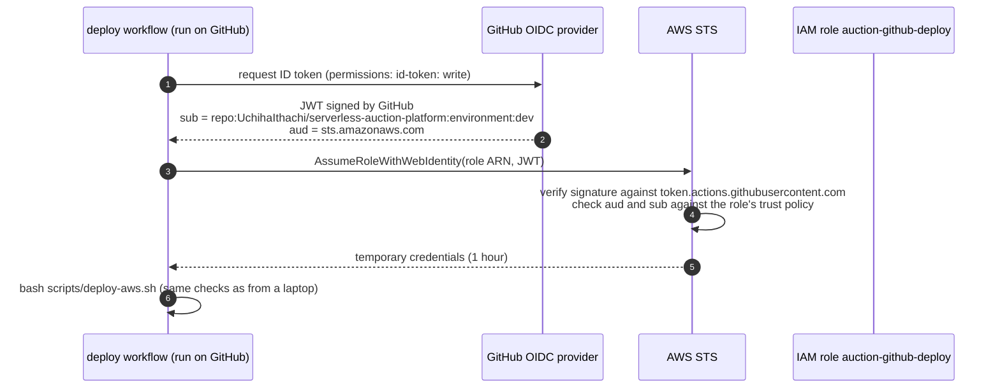

# Deploying from GitHub Actions with OIDC (no AWS keys)

`.github/workflows/deploy.yml` deploys with **short-lived credentials** instead of stored access keys:



Nothing secret is stored in GitHub except the Auth0 signing certificate, and that one is public anyway. If the repository is compromised, the attacker gets a role that only works from this repository's `dev`/`prod` environments, for an hour at a time.

**Status:** written and syntax-checked, never run. It needs a real AWS account, and this project runs at $0 on LocalStack. Until the variable `AWS_DEPLOY_ROLE_ARN` exists, the job is skipped.

## One-time setup (when there is an AWS account)

### 1. Trust GitHub's OIDC provider (once per account)

```bash
aws iam create-open-id-connect-provider \
  --url https://token.actions.githubusercontent.com \
  --client-id-list sts.amazonaws.com
```

(AWS no longer needs a thumbprint for this provider; older CLI versions may still ask for one.)

### 2. The deploy role: trust policy

Only workflows of **this repository**, running in the GitHub environment `dev` or `prod`, can assume it:

```json
{
  "Version": "2012-10-17",
  "Statement": [{
    "Effect": "Allow",
    "Principal": { "Federated": "arn:aws:iam::<ACCOUNT_ID>:oidc-provider/token.actions.githubusercontent.com" },
    "Action": "sts:AssumeRoleWithWebIdentity",
    "Condition": {
      "StringEquals": { "token.actions.githubusercontent.com:aud": "sts.amazonaws.com" },
      "StringLike": {
        "token.actions.githubusercontent.com:sub": [
          "repo:UchihaIthachi/serverless-auction-platform:environment:dev",
          "repo:UchihaIthachi/serverless-auction-platform:environment:prod"
        ]
      }
    }
  }]
}
```

Matching on the `environment:` subject (not `ref:refs/heads/*`) means the GitHub environment's protection rules apply: put **required reviewers on `prod`**, so a prod deploy waits for an approval.

### 3. The deploy role: permissions

`serverless deploy` drives CloudFormation, which creates Lambda functions, IAM roles, DynamoDB tables, SQS queues, an SNS topic, CloudWatch alarms, an S3 bucket, a CloudFront distribution and EventBridge rules. Two ways to grant that:

- **Simpler:** give the role permissions for those services, scoped by name to `auth-service-*`, `auction-service-*`, `notification-service-*`, `auction-*`, `AuctionsTable-*`, `OutboxTable-*` and `MailQueue-*`. After the first deploy, use IAM Access Analyzer's *generate policy from CloudTrail* on the role to cut it down to what was actually used.
- **Tighter (recommended):** a separate *CloudFormation execution role* that holds those permissions, and a deploy role that can only call CloudFormation, read/write the Serverless deployment bucket, and `iam:PassRole` that one execution role (Serverless: `provider.iam.deploymentRole`). Then the GitHub token can't touch resources directly, only through the reviewed templates.

`scripts/deploy-aws.sh` also checks that a budget exists, so add `budgets:ViewBudget`. It also checks the SES identity: add `ses:GetEmailIdentity`.

### 4. GitHub settings

| Kind | Name | Value |
|---|---|---|
| Variable | `AWS_DEPLOY_ROLE_ARN` | `arn:aws:iam::<ACCOUNT_ID>:role/auction-github-deploy` |
| Variable | `AWS_REGION` | `us-east-1` |
| Variable | `AUTH0_AUDIENCE`, `AUTH0_ISSUER` | from the Auth0 API settings |
| Variable | `SENDER_EMAIL` | the SES-verified sender |
| Variable | `ALERT_EMAIL` | where alarms go (optional) |
| Secret | `AUTH0_PUBLIC_KEY` | the Auth0 signing certificate (PEM) |
| Environments | `dev`, `prod` | `prod` with required reviewers |

Then: **Actions → deploy → Run workflow → stage**.
